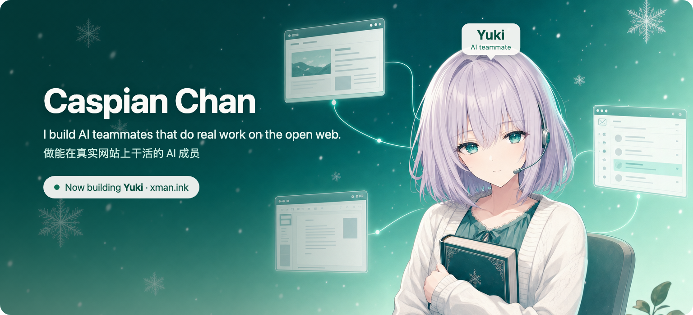

### Now building: Yuki

AI teammates, each with its own computer. Every teammate has a name, a job and its own cloud desktop. You hand out work in a chat or a group, the way you would with coworkers; they pick it up, finish it on their own and bring the results back to the conversation. They only come to you when something needs your decision.

每个都有自己电脑的 AI 成员。每个成员有名字、有分工、有自己的一台云电脑。你像跟同事一样在聊天或群里派活；它们自己接、自己做完，把结果带回对话里，只有要你拍板的事才来找你。

**Try it** · [xman.ink](https://xman.ink)  
**Repo** · [caspianchan31/yuki](https://github.com/caspianchan31/yuki)  
**Open-source roots** · [openmuse‑standalone](https://github.com/caspianchan31/openmuse-standalone): a self-hosted personal agent whose conversations live in your own Postgres.

### Mac apps

| Project | What it does |
|:---|:---|
| [in0](https://github.com/caspianchan31/in0) | A native macOS terminal multiplexer that shows your AI agents' live status. libghostty, SwiftUI and AppKit. |
| [voiceBox](https://github.com/caspianchan31/voiceBox) | Clone any voice and read anything, fully on your Mac with MLX on Apple Silicon. |
| [LiveLight](https://github.com/caspianchan31/LiveLight) | Auto lighting for live streams: the camera watches your face and tunes the light's brightness and color. 直播间自动打光。 |

### Agent skills and dev tools

| Project | What it does |
|:---|:---|
| [claude‑code‑browser](https://github.com/caspianchan31/claude-code-browser) | See every local repo as a card and launch Claude Code in any of them. One Python file. |
| [edit‑talking‑head‑video](https://github.com/caspianchan31/edit-talking-head-video) | A Claude Code and Codex skill that edits talking-head videos without changing a word you said. |
| [duibiao‑skills](https://github.com/caspianchan31/duibiao-skills) | Claude Code skills for researching benchmark accounts on Xiaohongshu. 小红书对标调研。 |
| [apple‑silicon‑local‑llm](https://github.com/caspianchan31/apple-silicon-local-llm) | Everything about running local LLMs on Apple Silicon. 在 Apple Silicon 上跑本地大模型。 |

### Also

[robot‑intro‑book](https://github.com/caspianchan31/robot-intro-book): companion code for the book 《智能机器人导论》, on ROS 2 Jazzy and Gazebo Harmonic.  
[airport‑autopilot](https://github.com/caspianchan31/airport-autopilot): support, privacy and credits pages for the app Airport Autopilot.
