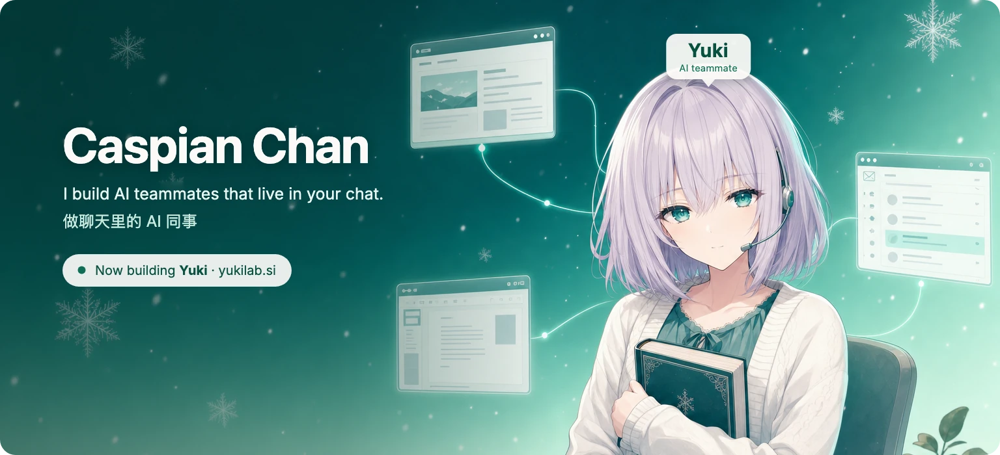

  

  <strong><a href="https://yukilab.si">Try Yuki</a></strong> &nbsp;·&nbsp; <a href="https://github.com/caspianchan31/yuki">Source code</a> &nbsp;·&nbsp; <a href="https://github.com/caspianchan31/yuki/blob/main/README.zh-CN.md">中文介绍</a>

### Now building: Yuki

**AI teammates in your chat.** Open it and Yuki is already there: tell it what you need in one sentence. Add teammates when you want help and put them in a group; they hand work to each other where you can see it, and come to you only when something needs your decision. The core is source-available, so you can run it on your own machine.

**聊天里的 AI 同事。** 打开就有 Yuki，一句话告诉它做什么；需要帮手就加成员、拉进群，它们在对话里互相交接，只有要你拍板的事才来找你。核心源码公开，可以跑在你自己的电脑上。

### Mac apps

| Project | What it does |
|:---|:---|
| [in0](https://github.com/caspianchan31/in0) | A native macOS terminal multiplexer that shows your AI agents' live status. libghostty, SwiftUI and AppKit. |
| [voiceBox](https://github.com/caspianchan31/voiceBox) | Clone any voice and read anything, fully on your Mac with MLX on Apple Silicon. |
| [LiveLight](https://github.com/caspianchan31/LiveLight) | Auto lighting for live streams: the camera watches your face and tunes the light's brightness and color. 直播间自动打光。 |

### Agent skills and dev tools

| Project | What it does |
|:---|:---|
| [claude‑code‑browser](https://github.com/caspianchan31/claude-code-browser) | See every local repo as a card and launch Claude Code in any of them. One Python file. |
| [edit‑talking‑head‑video](https://github.com/caspianchan31/edit-talking-head-video) | A Claude Code and Codex skill that edits talking-head videos without changing a word you said. |
| [duibiao‑skills](https://github.com/caspianchan31/duibiao-skills) | Claude Code skills for researching benchmark accounts on Xiaohongshu. 小红书对标调研。 |
| [apple‑silicon‑local‑llm](https://github.com/caspianchan31/apple-silicon-local-llm) | Everything about running local LLMs on Apple Silicon. 在 Apple Silicon 上跑本地大模型。 |

### Also

[openmuse‑standalone](https://github.com/caspianchan31/openmuse-standalone): the earlier self-hosted personal agent, with conversations in your own Postgres.  
[robot‑intro‑book](https://github.com/caspianchan31/robot-intro-book): companion code for the book 《智能机器人导论》, on ROS 2 Jazzy and Gazebo Harmonic.  
[airport‑autopilot](https://github.com/caspianchan31/airport-autopilot): support, privacy and credits pages for the app Airport Autopilot.
